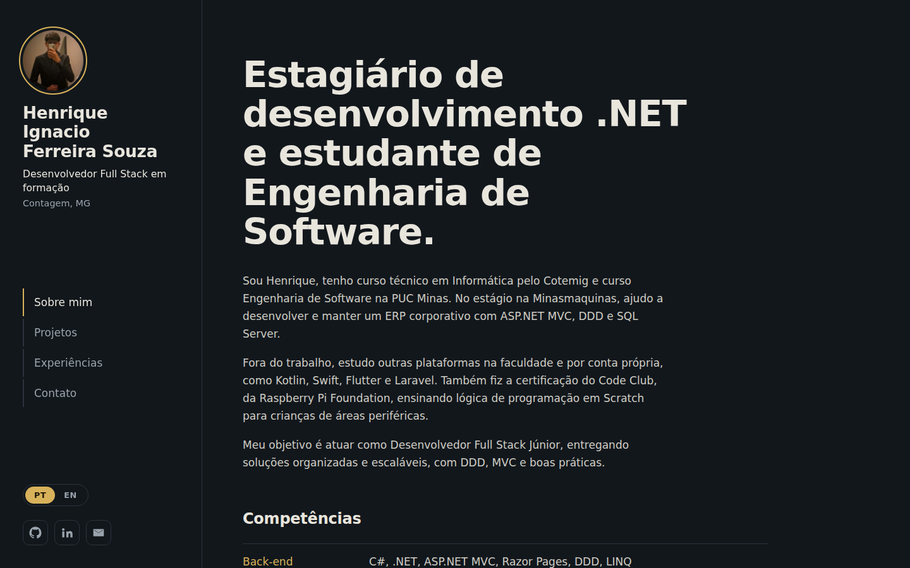
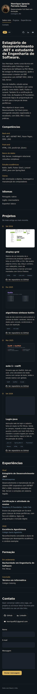

# 💼 Portfólio Profissional — Henrique Ignacio

> [!NOTE]
> Site de portfólio bilíngue (português e inglês) para apresentar minha formação, projetos, experiências e formas de contato. Feito em **React + Vite** para o **Laboratório 01** de Desenvolvimento e Integração de Aplicações Web (PUC Minas).

---

## 🔗 Links Úteis

* 🌐 **Site publicado:** [`COLE AQUI O LINK DA VERCEL`](https://seu-portfolio.vercel.app)
* 🧑‍💻 **GitHub:** https://github.com/Henrique-Ignacio
* 💼 **LinkedIn:** https://www.linkedin.com/in/henrique-ignacio-ferreira-souza-6517562b9/

---

## 📚 Índice
- [Sobre o Projeto](#-sobre-o-projeto)
- [Funcionalidades](#-funcionalidades)
- [Tecnologias Utilizadas](#-tecnologias-utilizadas)
- [Dependências](#-dependências)
- [Estrutura de Pastas](#-estrutura-de-pastas)
- [Instalação e Execução](#-instalação-e-execução)
- [Variáveis de Ambiente (EmailJS)](#-variáveis-de-ambiente-emailjs)
- [Deploy na Vercel](#-deploy-na-vercel)
- [Demonstração](#-demonstração)
- [Decisões de design](#-decisões-de-design)
- [Autor](#-autor)

---

## 📝 Sobre o Projeto

Portfólio profissional de uma página só, com menu lateral de navegação. Ele reúne:

1. **Sobre mim**, com apresentação em português e inglês, competências e idiomas.
2. **Projetos**, em uma linha do tempo do mais antigo ao mais recente. Cada projeto tem nome, descrição, tecnologias, link do repositório e imagem.
3. **Experiências**, com estágio, atividades e formação.
4. **Contato**, com ícones de GitHub, LinkedIn e e-mail e um formulário (nome, e-mail e mensagem) que envia a mensagem por e-mail.

## ✨ Funcionalidades

- 🌎 **Troca de idioma PT/EN** em todo o conteúdo, com a escolha salva no navegador.
- 🕰️ **Linha do tempo de projetos** gerada a partir de uma lista de dados (`src/content.js`).
- 📨 **Formulário de contato** com validação (nome, e-mail válido e mensagem com 10+ caracteres) e envio por **EmailJS**.
- 📱 **Layout responsivo**: menu lateral no desktop e menu no topo no celular.
- ♿ Foco visível no teclado, rótulos nos campos, mensagens de erro associadas e respeito a `prefers-reduced-motion`.

## 🛠 Tecnologias Utilizadas

### 💻 Front-end

* **Biblioteca:** React 19
* **Linguagem:** JavaScript (ES modules) e JSX
* **Estilização:** CSS puro, com variáveis CSS
* **Fontes:** Bricolage Grotesque e IBM Plex Sans (Google Fonts)
* **Build tool:** Vite 7
* **E-mail:** EmailJS (`@emailjs/browser`)

### ⚙️ Infraestrutura

* **Hospedagem:** Vercel
* **Controle de versão:** Git e GitHub

## 📦 Dependências

| Pacote | Versão | Para que serve |
| :--- | :--- | :--- |
| `react` | ^19 | Interface em componentes |
| `react-dom` | ^19 | Renderização no navegador |
| `@emailjs/browser` | ^4.4 | Envio do formulário por e-mail |
| `vite` | ^7 | Servidor de desenvolvimento e build |
| `@vitejs/plugin-react` | ^5 | Suporte a JSX/React no Vite |

## 📂 Estrutura de Pastas

```
.
├── index.html            # Página base e carregamento das fontes
├── package.json          # Dependências e scripts
├── vite.config.js        # Configuração do Vite
├── .env.example          # Modelo das variáveis do EmailJS
├── docs/                 # Prints usados neste README
├── public/
│   ├── favicon.svg
│   └── assets/           # Foto e imagens dos projetos
└── src/
    ├── main.jsx          # Ponto de entrada do React
    ├── App.jsx           # Menu lateral e seções (Sobre, Projetos, Experiências, Contato)
    ├── content.js        # Textos em PT/EN, lista de projetos e links
    └── styles.css        # Tema escuro, layout e responsividade
```

## 🔧 Instalação e Execução

### Pré-requisitos

* **Node.js** versão LTS (18 ou superior)
* **npm**

### Passo a passo

```bash
git clone https://github.com/Henrique-Ignacio/<nome-do-repositorio>.git
cd <nome-do-repositorio>
npm install
cp .env.example .env.local   # depois preencha as chaves do EmailJS
npm run dev
```

O site abre em **http://localhost:5173**.

Para gerar a versão de produção e testá-la localmente:

```bash
npm run build
npm run preview
```

## 🔑 Variáveis de Ambiente (EmailJS)

O formulário usa o [EmailJS](https://www.emailjs.com/), que envia o e-mail direto do front-end.

1. Crie uma conta e adicione um **Email Service** (por exemplo, Gmail) para o e-mail que vai receber as mensagens.
2. Crie um **Email Template** usando estas variáveis no corpo e no assunto: `{{from_name}}`, `{{reply_to}}` e `{{message}}`.
3. Copie o **Service ID**, o **Template ID** e a **Public Key** e coloque em `.env.local`:

| Variável | Descrição |
| :--- | :--- |
| `VITE_EMAILJS_SERVICE_ID` | ID do serviço de e-mail |
| `VITE_EMAILJS_TEMPLATE_ID` | ID do template |
| `VITE_EMAILJS_PUBLIC_KEY` | Chave pública da conta |

> [!NOTE]
> Se essas variáveis não estiverem configuradas, o formulário continua funcionando: ele abre o aplicativo de e-mail do visitante com a mensagem pronta (`mailto:`).

## 🚀 Deploy na Vercel

1. Suba o projeto para um repositório no GitHub.
2. Em [vercel.com](https://vercel.com), clique em **Add New → Project** e importe o repositório.
3. A Vercel detecta o Vite sozinha (build `npm run build`, pasta de saída `dist`).
4. Em **Settings → Environment Variables**, cadastre as três variáveis do EmailJS.
5. Clique em **Deploy** e copie o link gerado para a seção **Links Úteis** deste README.

## 🎥 Demonstração

| Desktop | Celular |
| :---: | :---: |
|  |  |

## 🎨 Decisões de design

- **Tema escuro em grafite com dourado**, uma referência ao ouro de Minas Gerais. O dourado aparece só onde indica algo: item ativo do menu, datas da linha do tempo, botão principal e foco do teclado.
- **Menu lateral fixo** no desktop, para manter a navegação sempre à vista, e menu no topo no celular.
- **Arquitetura simples**: todo o conteúdo fica em `src/content.js`, então adicionar um projeto novo é adicionar um item na lista.

## 👤 Autor

| 👤 Nome | 🐙 GitHub | 💼 LinkedIn | 📤 E-mail |
|---------|-----------|-------------|-----------|
| Henrique Ignacio Ferreira Souza | [Henrique-Ignacio](https://github.com/Henrique-Ignacio) | [LinkedIn](https://www.linkedin.com/in/henrique-ignacio-ferreira-souza-6517562b9/) | [henriquef621@gmail.com](mailto:henriquef621@gmail.com) |

---
